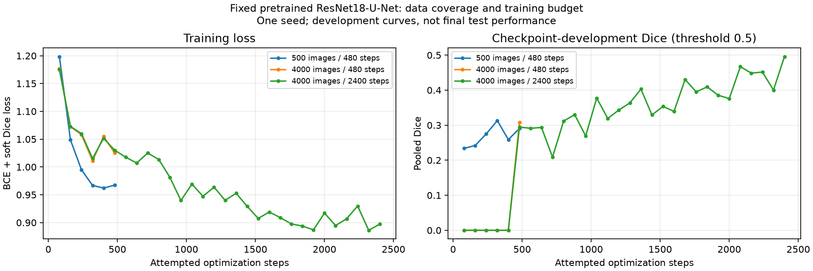

# 工业表面异常检测与定位 / Industrial Surface Anomaly Inspection

基于 PyTorch 的工业表面视觉检测项目：已完成瓶子验证、钢材滑窗、异常检测、监督分割与训练扩展。最新确定性3种子开发实验：Dice均值0.5237±0.0185、图像AUROC均值0.8161±0.0352；报警召回仍波动明显，尚不可部署，测试集保留。下文按阶段记录，最新结论见[复现报告](reports/deterministic_replication.md)。

A PyTorch surface-inspection project with bottle validation, steel tiling, anomaly detection, segmentation and expanded training. Latest deterministic three-seed development mean±sample SD: Dice 0.5237±0.0185, image AUROC 0.8161±0.0352. Alarms remain unstable; not deployable, test data reserved. See the latest [replication report](reports/deterministic_replication.md).

## 进展 / Progress

| 阶段 / Stage | 状态 / Status |
|---|---|
| GPU 环境与 ResNet18 特征提取 / GPU setup and feature extraction | 已完成 / Complete |
| bottle 全局特征基线 / Global-feature baseline | 已完成 / Complete |
| bottle 局部特征与热力图 / Local features and heatmaps | 已完成 / Complete |
| 钢材 RLE 检查与固定划分 / Steel RLE audit and fixed split | 已完成 / Complete |
| 钢材滑窗与拼接 / Steel tiling and stitching | 已完成 / Complete |
| 钢材异常检测首轮试验 / Steel anomaly pilot | 已跑通，效果不合格 / Runs; inadequate detection |
| 轻量 U-Net 监督分割对照 / Supervised U-Net pilot | 已完成首轮，效果仍不足 / Initial run complete, inadequate |
| 预训练编码器与训练扩展 / Pretraining and training expansion | 已完成开发实验，未达部署要求 / Development runs complete, not deployable |
| 本机确定性与3种子复验 / Local determinism and three seeds | 80步训练状态及单图跨进程一致性通过 / 80-step state and single-input replay verified |
| 实际采集验证 / Field validation | 待实现 / Planned |

## 方法 / Methods

- 全局基线：冻结 ResNet18，512 维特征 L2 单位化，计算到正常特征库的最近邻距离。
  Global baseline: frozen ResNet18, unit-normalized 512-D embeddings, nearest-normal-neighbor distance.
- 局部方法：layer2/layer3 局部聚合、投影贪心 coreset（1%）、局部最近邻异常图。
  Local method: layer2/layer3 aggregation, projected greedy coreset (1%), and patch nearest-neighbor maps.
- 局部方法是 PatchCore 简化实现，不是原论文标准复现，详见阶段报告。
  This is a simplified PatchCore-style implementation, not a standard paper reproduction; see the stage report.
- 正常特征库只使用正常训练图。图像报警阈值使用正常验证图分数的第 95 百分位。
  Memory banks use normal training images only. Image thresholds use the normal-validation 95th percentile.

## 结果与限制 / Results and limitations

| bottle 指标 / Metric | 全局 / Global | 局部 / Local |
|---|---:|---:|
| Image AUROC | 0.992857 | 1.000000 |
| 缺陷检出 / Defects detected | 63/63 | 63/63 |
| 正常误报 / Normal false alarms | 2/20 | 1/20 |
| Pixel AUROC at 256×256 | — | 0.982241 |

以上为固定划分、单类别的探索性结果，不代表真实产线效果。像素指标在 256×256 下计算。热力图不是概率，也不是精确二值边界。测试结果已在开发中查看，后续研究需独立数据检验泛化。

These are exploratory single-category results, not production validation. Pixel metrics use 256×256 masks. Heatmaps are not probabilities or precise binary boundaries. Test results have been inspected during development; independent data is needed for generalization claims.

## 环境 / Environment

实测 / Tested: Windows, Python 3.12, RTX 5060 Laptop 8 GB, PyTorch 2.15.0+cu132, TorchVision 0.29.2+cu132. 实际兼容版本应结合驱动和 PyTorch 官方发布情况选择。 / Select compatible releases for your driver when recreating the environment.

```powershell
conda create -n surface-inspection python=3.12
conda activate surface-inspection
python -m pip install torch==2.15.0 torchvision==0.29.2 --index-url https://download.pytorch.org/whl/cu132
python -m pip install numpy==2.5.5 Pillow==13.0.0 scikit-learn==1.9.1
```

所有命令在克隆后的仓库根目录执行，不需要原作者电脑的绝对路径。
Run all commands from the cloned repository root; no author-specific absolute paths are required.

## 数据与权重 / Data and weights

数据、预训练权重、运行输出和本机环境快照不上传。请从原发布方下载并遵守条款，见 [THIRD_PARTY.md](THIRD_PARTY.md)。
Datasets, pretrained weights, run outputs, and machine snapshots are excluded. Download separately under the original terms; see [THIRD_PARTY.md](THIRD_PARTY.md).

```text
data/
  mvtec_ad/bottle/       # contains train/, test/, ground_truth/; extra bottle/ nesting supported
  severstal/
    train.csv
    train_images/       # JPGs directly under severstal/ are also supported
weights/
  resnet18-f37072fd.pth
```

```powershell
Invoke-WebRequest -Uri 'https://download.pytorch.org/models/resnet18-f37072fd.pth' -OutFile 'weights/resnet18-f37072fd.pth'
python scripts/check_environment.py
python scripts/extract_features.py
python -m unittest discover -s tests -v
```

## bottle 复现 / Reproduce bottle

```powershell
python scripts/prepare_bottle.py
python scripts/run_baseline.py
python scripts/run_patchcore.py
```

原实验目录有额外 bottle/bottle 层。`prepare_bottle.py` 会重新生成适合实际路径的清单。保持相同文件和 seed 可复现划分；脚本修改原始数据时会拒绝后续校验。
The original experiment used an extra bottle/bottle layer. Regenerate the manifest for your actual layout. The same files and seed reproduce the split; downstream hash checks reject changed image data.

单张推理 / Single-image inference (after building the bank):

```powershell
python scripts/run_patchcore.py --image assets/synthetic_inspection_sample.png
```

上述合成图仅验证接口，不应当作有效瓶子检测实验。换成真实、存在的图片路径；任意手机照片可能不符合特征库的拍摄分布。
The synthetic fixture only checks the interface. Replace it with an existing real image path; arbitrary phone photos may be out of distribution.

结果位于 / Outputs: `runs/global_baseline/`, `runs/patchcore_lite/`. 局部方法生成 / Local method generates: `localization_preview.png`, `single_heatmap.png` (single-image mode), metrics, predictions, and raw anomaly maps.

## 钢材数据 / Steel data

```powershell
python scripts/audit_severstal.py
python scripts/split_severstal.py
```

| 集合 / Split | 全部 / Total | 正常 / Normal | 缺陷 / Defect |
|---|---:|---:|---:|
| Train | 8800 | 4132 | 4668 |
| Validation | 1886 | 885 | 1001 |
| Test | 1882 | 885 | 997 |

按原图、缺陷类别组合分层，seed=42，约 70/15/15；罕见组合受整数分配限制。每张图仅进入一个集合，后续所有切块必须继承原图集合。仅 `use_for_memory_bank=true` 的正常训练图可加入正常库。
Image-level class-combination stratification, seed 42, approximately 70/15/15; rare strata have rounding limitations. All future tiles must inherit their source split. Only normal training samples marked `use_for_memory_bank=true` may enter the memory bank.

固定清单在 `configs/`；已有清单若与新划分不同，脚本拒绝覆盖。无生产批次 ID；文件哈希不重复不代表不存在近重复或同批次相关性。
Frozen manifests are in `configs/`; changed assignments are rejected. No production batch IDs are supplied, so exact-file checks cannot establish batch independence or rule out near duplicates.

## 项目结构 / Structure

- `src/`: 特征与评分 / feature extraction and scoring.
- `scripts/`: 检查、建库、推理、评估 / audits, memory banks, inference, evaluation.
- `tests/`: 距离、掩码、划分检查 / distance, mask, and split tests.
- `configs/`: 固定样本身份、标签与校验值 / fixed sample identities, labels, hashes.
- `reports/`: 阶段报告与实验指标 / stage reports and metrics (historical detailed reports are in Chinese).
- `assets/`: 人工合成测试图 / synthetic fixture.

## 钢材滑窗与拼接 / Steel tiling and stitching

```powershell
python scripts/check_steel_tiling.py
python -m unittest discover -s tests -v
```

每张 1600×256 原图按 256×256、步长 128 切为 12 块，最后一块起点为 x=1344，确保完整覆盖。直接裁切，不缩放原图。小块继承原图 split，不再随机划分；正常训练子集共有 49,584 个可读取小块。

Each 1600×256 image yields twelve 256×256 crops at stride 128, with the final start anchored at x=1344. No image resizing is applied. Tiles inherit the source split; 49,584 normal-training tiles are available on demand.

`src/severstal_tiles.py` 提供 PyTorch Dataset，返回归一化图片、掩码、原图身份、坐标和有效区域。掩码按原图坐标裁切。只缓存最近一张原图和掩码，不保存全部切块。当前顺序读取更高效；全局随机小块读取会重复解码原图，训练时应考虑按原图组织采样。

The Dataset returns normalized RGB, mask, parent identity, coordinates, and valid region. It caches only the most recent source image and mask. Sequential access avoids repeated image decoding; future training should consider image-grouped sampling.

`src/tiling.py` 的 Stitcher 对重叠区域取平均，拒绝缺失覆盖和非有限预测。小图使用边缘填充，掩码补零；拼接时丢弃填充区域。模型输出的低分辨率异常图须先上采样到小块尺寸后再拼接。

Stitcher averages overlapping scores and rejects uncovered pixels or nonfinite values. Small RGB images use edge padding, masks use zero padding, and padding is discarded on stitching. Upsample model maps to tile resolution before adding them.

已通过 16 项测试；另用 5 张正常/各类缺陷训练图检查 RGB 与掩码精确重建，验证 DataLoader 输出 `[8,3,256,256]`。详细记录见 `reports/steel_tiling_checks.json`，本机预览为 `runs/steel_tiling/tiling_preview.png`。预览不上传数据集图片。

All 16 tests pass. Five real training examples covering normal and all defect classes reconstruct RGB and masks exactly; DataLoader shape is `[8,3,256,256]`. The report is `reports/steel_tiling_checks.json`; the local preview is `runs/steel_tiling/tiling_preview.png` and is not distributed.

本阶段仅验证分块几何与数据读取，尚未运行钢材模型。切块与重叠拼接不能保证模型对接缝完全不敏感，后续应单独检查边缘缺陷和接缝响应。

This stage validates geometry and loading, not steel detection performance. Overlap averaging does not guarantee seam-free model predictions; boundary defects and seam responses require later evaluation.

下一步 / Next: steel anomaly experiments with bounded memory, followed by a supervised segmentation baseline.

## 钢材首轮实验 / Steel pilot (2026-11-23)

```powershell
python scripts/run_steel_pilot.py
python -m unittest discover -s tests -v
```

固定选择 300 张正常训练图、200 张正常验证图校准阈值，以及另外 100 张正常+100 张缺陷验证图作开发评估。选择清单在 `configs/steel_pilot_selection.json`，彼此不重叠，不读取测试图片。

Fixed selection: 300 normal training images, 200 normal validation images for threshold calibration, and a disjoint validation evaluation subset of 100 normal and 100 defective images. Identities are in `configs/steel_pilot_selection.json`. No test images are accessed.

每块随机抽取 32 个局部特征，产生 115200 个候选，再投影贪心选取 2048 个原始 384 维特征。模型保持冻结。每张图的分数是滑窗异常图平滑、拼接后的最大值；阈值取正常校准图分数的第 95 百分位。

Sample 32 local features per tile, yielding 115200 candidates, then select 2048 original 384-D descriptors by projected greedy coreset. The frozen model scores each image by the maximum stitched smoothed anomaly map. Threshold calibration uses the normal-score 95th percentile.

| 开发验证指标 / Development-validation metric | 结果 / Result |
|---|---:|
| Image AUROC | 0.5205 |
| 缺陷检出 / Defects detected | 3/100 |
| 正常误报 / Normal false alarms | 11/100 |
| 缺陷图逐图像素 AUROC 的均值 / Mean per-defective-image pixel AUROC | 0.930568 |

**检测效果不合格，不能作为可用钢材检测器。** 最后一项只衡量每张缺陷图内部的像素排序，是 100 张缺陷图各自 AUROC 的均值，不是跨图汇总像素 AUROC，也不包含正常图片。因此不能据此认为检测成功或与瓶子像素指标直接比较。

**Detection is inadequate; this is not a usable steel detector.** The last metric averages within-image pixel AUROC across 100 defective images. It is not pooled pixel AUROC and excludes normal images, so it cannot establish successful image detection or be directly compared to bottle's pixel metric.

实测峰值 PyTorch 显存约 225.5 MiB、建库约 6.1 秒、全流程约 26.4 秒（含 I/O、校准和验证，不是标准延迟基准）。17 项测试通过，保存重载和单图入口均验证。详情在 `reports/steel_pilot_metrics.json`。

Measured peak PyTorch allocation: ~225.5 MiB. Bank construction: ~6.1 s; complete pipeline: ~26.4 s including I/O, calibration, and validation (not a latency benchmark). All 17 tests pass; bank reloading and single-image inference are verified. See `reports/steel_pilot_metrics.json`.

输出 / Outputs: `runs/steel_pilot/bank.pt`, `validation_predictions.csv`, `validation_preview.png`, `metrics.json`. 单图模式 / Single-image mode (after bank construction):

```powershell
python scripts/run_steel_pilot.py --image data/severstal/034941f9d.jpg
```

该图为本轮缺陷验证图，当前模型漏检；保留它用于展示失败，不作为成功演示。生成 `single_overlay.png`、`single_map.npy`、`single_prediction.json`。不同目录布局时替换为存在的路径。

This is a defective validation example missed by the pilot, intentionally retained as a failure case. Outputs are `single_overlay.png`, `single_map.npy`, and `single_prediction.json`; adjust the path if the data layout differs.

### 失败诊断已完成 / Failure diagnosis completed

详见 [钢材失败分析 / Steel failure analysis](reports/steel_failure_analysis.md)。在固定校准和验证集上，排除边缘、改用分位数/相对分数、将特征库扩大四倍，均未解决图像级识别失败。缺陷图中 74/100 的最高分位于标注内，说明“图内定位”与“跨图异常判断”存在明显差异。测试集未使用，原模型未修改。下一步优先做监督分割对照。

Border exclusion, quantile/relative scoring, and a fourfold larger bank did not resolve image-level detection. Peaks lie inside annotations in 74/100 defective images, showing the distinction between within-image localization and cross-image detection. Test images remain untouched and the original bank is unchanged. Prioritize a supervised segmentation baseline next.

```powershell
python scripts/diagnose_steel.py
python scripts/diagnose_steel_capacity.py
```

## 轻量 U-Net 监督训练 / Supervised lightweight U-Net

```powershell
python scripts/train_steel_unet.py
python scripts/train_steel_unet.py --image data/severstal/034941f9d.jpg
python -m unittest discover -s tests -v
```

SmallUNet 从零训练，488001 参数，GroupNorm，BCE+soft Dice，AdamW，CUDA 混合精度。保持原图划分、256×256 切块与重叠平均。4 类掩码合并为二值缺陷。固定选择 250 张正常+250 张缺陷训练图，索引为 1210 个含缺陷块和 4790 个无缺陷块。每批各采样 4 个，有放回；图片与掩码同步翻转。

SmallUNet is trained from scratch: 488001 parameters, GroupNorm, BCE plus soft Dice, AdamW, CUDA mixed precision. Original-image splits, 256×256 tiles, and overlap averaging are preserved. Four classes are merged into one binary defect mask. A fixed 250-normal/250-defective parent-image pool yields 1210 positive and 4790 negative tiles. Each batch samples four of each with replacement and paired flips.

本轮训练 6 轮、每轮 80 次更新，共 480 次；“轮”不是遍历全部训练图的 epoch。80 张独立开发验证图用于按固定 0.5 阈值的 pooled Dice 选检查点，并用于选择像素阈值。第 5 轮最佳，像素阈值 0.4；图像阈值由原 200 张正常校准图确定。最后在与异常基线相同的 100 正常+100 缺陷验证图上评估，不读取测试图片。

Six rounds of 80 updates give 480 updates, not six full dataset epochs. Eighty separate development-validation images select the checkpoint by pooled Dice at threshold 0.5, then select the pixel threshold. Round 5 is best, pixel threshold 0.4. The same 200 normal calibration images determine the image threshold. Evaluation uses the original 100 normal and 100 defective validation images; no test images are read.

| 相同评估子集 / Same evaluation subset | 正常特征库 / Memory bank | U-Net |
|---|---:|---:|
| Image AUROC | 0.5205 | 0.7204 |
| 缺陷检出 / Detected | 3/100 | 25/100 |
| 正常误报 / False alarms | 11/100 | 7/100 |

U-Net 全部 200 张图的 pooled pixel Dice=0.2877、IoU=0.1680，缺陷图逐图 Dice 均值=0.4304。不能把不同定义的 Dice 混用。逐缺陷图像素 AUROC 均值=0.9143，低于之前 0.9306；监督方法没有在所有指标上同时提升。仍存在粗糙正常纹理误报、小缺陷漏检和大面积缺陷分割不足，不能用于产线。

U-Net pooled pixel Dice over all 200 images is 0.2877 and IoU is 0.1680; mean defective-image Dice is 0.4304. These are different aggregations. Mean per-defective-image pixel AUROC is 0.9143, below the earlier 0.9306, so not all metrics improve. Rough normal textures, small defects, and large defect regions remain failure modes; this is not production-ready.

两种方法使用不同监督信息与训练样本规模，不能将差异全部归因于架构。21 项测试通过，保存重载与单图推理通过。权重位于 `runs/steel_unet/best.pt`（本机保存，不上传 GitHub）；输出还包括验证预测、预览、metrics.json。训练曲线数值保存在 `reports/steel_unet_metrics.json` 的 history，固定选择在 `configs/steel_unet_selection.json`。

Supervision and training-set sizes differ, so this is not an architecture-only comparison. All 21 tests pass; checkpoint reload and single-image inference are verified. Weights remain local at `runs/steel_unet/best.pt`, alongside validation predictions, previews, and metrics. Numeric learning history is in `reports/steel_unet_metrics.json`; selected identities are in `configs/steel_unet_selection.json`.

实测训练与后续校准评估约 74 秒（不含前面的切块索引）、峰值 PyTorch 分配显存约 789 MiB。后续优先做类别/缺陷面积分组评估，检查训练样本覆盖与损失取舍，再决定扩大训练规模或使用预训练编码器。不是直接盲目增加训练轮数。

Training plus calibration/evaluation took ~74 seconds excluding initial tile indexing, with ~789 MiB peak PyTorch allocation. Next, analyze class/defect-area failures and training coverage before expanding training or using a pretrained encoder.

### U-Net 分组诊断 / U-Net grouped diagnosis

```powershell
python scripts/analyze_unet.py
```

详见 [类别与面积分析 / Class and area analysis](reports/steel_unet_failure_analysis.md)。第 2 类训练子集仅 9 张，验证 0/6 检出，类别像素召回约 2.49%。≥5% 大面积缺陷像素召回也只有 27.80%，不能仅归因于小缺陷。正常图虽然仅 7/100 报警，但 95/100 在像素阈值下有非空掩码；“图像误报率”与“分割误报”必须分别报告。

Class 2 has only 9 training images, 0/6 validation alarms and 2.49% class-pixel recall. Large defects (≥5% union area) have only 27.80% pixel recall. Although 7/100 normal images alarm, 95/100 have nonempty masks at the pixel threshold. Image alarms and segmentation false positives are distinct metrics.

本阶段未更新模型、阈值或测试集。24 项测试通过。下一步优先做类别覆盖/抽样的单变量对照，不同时改动架构、损失或训练预算。

Model and thresholds are unchanged, test data remains untouched, and all 24 tests pass. Next prioritize a single-variable class-coverage/sampling experiment without changing architecture, loss or training budget.

下一步分析正常/缺陷分数重叠、边缘与接缝响应、候选抽样和纹理差异，再选择受控改动或监督分割对照。上述原因目前是待验证假设，不能作为已确认结论。钢材测试集保留用于最终配置评价。

Next: investigate score overlap, boundary/seam responses, candidate sampling, and texture variation, then run controlled changes or supervised segmentation. These are hypotheses, not confirmed causes. The steel test split remains reserved for final evaluation.

## 类别覆盖与预训练对照 / Coverage and pretraining experiments

已完成三组新增训练，详见 [中英文对照报告 / Bilingual experiment report](reports/unet_controlled_experiments.md)。保持原数据划分、检查点/校准/评估身份、损失与 480 次优化步骤预算；不使用测试图片。

Three additional runs are complete. Original splits, validation identities, loss and 480-step budget are held fixed; test images remain untouched.

| 方法 / Method | Image AUROC | TP/100 | FP/100 | Pooled Dice |
|---|---:|---:|---:|---:|
| 原小 U-Net / Original | 0.7204 | 25 | 7 | 0.2877 |
| 类别覆盖 / Balanced coverage | 0.7204 | 15 | 8 | 0.2883 |
| ResNet18 随机 / Random encoder | 0.6541 | 5 | 2 | 0.2750 |
| ResNet18 预训练 / Pretrained encoder | 0.6121 | 10 | 3 | 0.3443 |

```powershell
python scripts/train_steel_unet.py --coverage-balanced
python scripts/train_steel_unet.py --coverage-balanced --encoder random-resnet18
python scripts/train_steel_unet.py --coverage-balanced --encoder pretrained-resnet18
python scripts/compare_unet_experiments.py
```

平衡版仍为 250 正常+250 缺陷，正常图完全不变，每个缺陷类别至少 60 张（多类图有重叠）。预训练与随机编码器结构相同、解码器初始参数相同，所有层参与训练。各实验输出独立保存为 `runs/steel_unet_balanced*`，对应清单和指标也分别保存。

Coverage-balanced runs retain the same 250 normal images and 250 defective images with at least 60 examples/class (overlapping classes). Matched random/pretrained encoders share architecture and initial decoder weights, with all layers trainable. Separate `runs/steel_unet_balanced*` outputs and matching selections/metrics preserve the original run.

单图推理 / Single-image inference:

```powershell
python scripts/train_steel_unet.py --coverage-balanced --encoder pretrained-resnet18 --image data/severstal/034941f9d.jpg
```

28 项测试通过。预训练提高本轮分割重叠，但未提升整体报警；类别覆盖改善第 2 类像素召回，但不保证总体改善。单一种子、短预算结果不能说明复杂模型或预训练必然更好/无用。下一阶段优先验证整图评分与区域级误报，测试集保持保留。

All 28 tests pass. Pretraining improves overlap but not overall alarms in this run. Better coverage helps class-2 pixel recall but not aggregate detection. Single-seed short-budget results do not establish universal superiority or futility. Next investigate image scoring and region-level false positives; keep test data reserved.

## 区域评分对照 / Region-scoring experiments

详见 [中英文报告 / Bilingual report](reports/region_scoring_experiments.md)。固定现有两模型，在原开发集选择区域过滤及评分规则，正常校准集确定阈值，评估子集不参与选择，测试集未使用。

Frozen-model experiments select cleanup/scoring on development images, thresholds on normal calibration, and evaluate the unchanged subset. No test images are used.

```powershell
python scripts/evaluate_region_scoring.py --model small
python scripts/evaluate_region_scoring.py --model pretrained
```

轻量模型开发集选定 top 0.1% 均值：评估 AUROC 0.7252，但检出降至 22/100（原为25/100），正常误报6/100（原7/100）。预训练模型仍选原最大概率，检出10/100、误报3/100。连通区域面积/概率总量未解决问题。

The small model selects top-0.1% mean: evaluation AUROC 0.7252, but recall falls to 22/100 (original 25/100), false alarms 6/100 (original 7/100). Pretrained selects original max probability: TP=10/100, FP=3/100. Component-area/mass rules do not resolve detection.

过滤小于256像素的连通区域后，正常非空掩码仍为92/100（轻量）和82/100（预训练），Dice基本不变。31项测试通过，检查点哈希保持不变。新规则单独保存在 `configs/*_region_rule.json`；原模型/默认入口不变。

Filtering regions below 256 pixels leaves nonempty masks in 92/100 small-model and 82/100 pretrained normal images; Dice barely changes. All 31 tests pass and checkpoint hashes are unchanged. New rules are separate experimental artifacts; original model/default entry points are preserved.

单图实验入口 / Single-image experimental entry:

```powershell
python scripts/evaluate_region_scoring.py --model pretrained --image data/severstal/034941f9d.jpg
```

输出在 `runs/*_regions/`，掩码不按整图报警门控。下一步优先改善训练覆盖和有效训练预算，而不是继续堆叠后处理。

Outputs are in `runs/*_regions/`; masks are not gated by image alarms. Prioritize training coverage and effective training budget over further heuristic stacking.

## 扩展训练 / Expanded training

完整方法与限制见[中英文报告 / Bilingual report](reports/training_scale_experiments.md)。原池500张扩展到4000张（2000正常、2000缺陷，均来自train且包含原500张），对照480与2400次优化步骤。模型、损失、验证身份与规则不变，测试集未使用。

The train pool grows from 500 to 4000 images (2000 normal/2000 defective, retaining the original pool). Compare 480 and 2400 steps with the same model, loss and validation rules; no test images are used.

| Pretrained ResNet18-U-Net | Image AUROC | TP/100 | FP/100 | Pooled Dice | Pooled IoU |
|---|---:|---:|---:|---:|---:|
| 500 images / 480 steps | 0.6121 | 10 | 3 | 0.3443 | 0.2079 |
| 4000 images / 480 steps | 0.5150 | 0 | 0 | 0.3657 | 0.2238 |
| 4000 images / 2400 steps | 0.7926 | 23 | 6 | 0.5218 | 0.3530 |

```powershell
python scripts/train_steel_unet.py --coverage-balanced --encoder pretrained-resnet18 --expanded
python scripts/train_steel_unet.py --coverage-balanced --encoder pretrained-resnet18 --expanded --rounds 30
python scripts/analyze_unet.py --coverage-balanced --encoder pretrained-resnet18 --expanded --rounds 30
python scripts/compare_training_scale.py
```

单图入口在同样参数后加 `--image` 和实际路径。扩展版权重与历史分别保存在各自 `runs/*_expanded*` 目录，不覆盖原版；每轮记录历史和最佳训练权重，不能将该简化训练快照当成完整优化器断点恢复。

Append `--image` and an existing path for inference. Expanded weights/history have separate `runs/*_expanded*` directories. Per-round best-weight snapshots do not include full optimizer state for resuming training.

长版本正常像素误报降至1.50%，但正常非空掩码仍94/100，整图召回仅23%；尚不可部署。32项测试通过。单种子且GPU训练未强制确定性，两次扩展实验的早期轨迹并非逐点一致；只能作为开发证据，不能宣称严格逐位复现或统计显著提升。

The longer run reduces normal-pixel FPR to 1.50% but still has nonempty masks in 94/100 normal images and only 23% image recall. All 32 tests pass. Single-seed GPU runs were not forced deterministic and early histories differ, so results are development evidence, not bitwise reproduction or statistical significance.

学习曲线 / Learning curves (optional matplotlib):

```powershell
python -m pip install -r requirements-plots.txt
python scripts/plot_training_scale.py
```



## 确定性与多种子 / Determinism and predefined seeds

完整方法与全部结果见[中英文复验报告 / Bilingual replication report](reports/deterministic_replication.md)。使用原4000张训练图和相同开发/校准/评估身份，每个预定种子训练2400步；不选评估成绩最好的种子。

Use the same 4000 training images and all original validation identities; each predefined seed trains 2400 steps. Do not select the best evaluation seed.

| Seed | Image AUROC | TP/100 | FP/100 | Pooled Dice |
|---|---:|---:|---:|---:|
| 42 | 0.7759 | 6 | 5 | 0.5096 |
| 43 | 0.8413 | 49 | 9 | 0.5168 |
| 44 | 0.8310 | 44 | 6 | 0.5446 |

开启严格确定性算法，关闭benchmark/TF32，CUDA初始化前设置cuBLAS工作区；训练随机流与数据选择分离。相同种子的初始状态、前80步后全部参数/缓冲区及首轮记录完全一致；一次单图概率图在两个独立进程逐像素一致。不是重复了两次完整2400步，也不保证跨软硬件复现。

Strict deterministic algorithms, benchmark/TF32 disabled, cuBLAS workspace configured before CUDA, and training RNG isolated from data selection. Same-seed initial state, 80-step parameter/buffer state and first-round history match exactly; one probability map matches across separate processes. This is not two complete 2400-step repeats or a cross-runtime guarantee.

```powershell
python scripts/train_steel_unet.py --coverage-balanced --encoder pretrained-resnet18 --expanded --rounds 1 --deterministic --seed 42
foreach ($trainingSeed in @(42,43,44)) {
  python scripts/train_steel_unet.py --coverage-balanced --encoder pretrained-resnet18 --expanded --rounds 30 --deterministic --seed $trainingSeed
  python scripts/analyze_unet.py --coverage-balanced --encoder pretrained-resnet18 --expanded --rounds 30 --deterministic --seed $trainingSeed
}
python scripts/check_deterministic_inference.py
python scripts/summarize_reproducibility.py
python scripts/plot_multiseed.py
```

35项测试通过。三次共用200张评估图，不是600个独立样本；标准差只描述训练波动。严格模式也改变了数值设置和训练随机流，不能与历史版本作纯粹“去掉随机性”的因果比较。下一步以预先指定seed=42为参考，检验显式分类监督，继续保留最终测试集。

All 35 tests pass. Runs reuse 200 images, not 600 independent examples; SD describes training variation only. Strict mode changes arithmetic and RNG handling, so historical differences are not solely attributable to removing nondeterminism. Follow-up controls use predeclared seed 42 and investigate explicit classification supervision; test data stays reserved.


