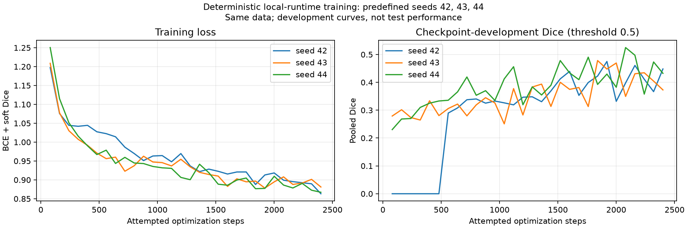

# 确定性训练与多种子复验 / Deterministic training and seed replication

日期 / Date: 2026-11-23

固定4000张训练图、原80张检查点验证图、200张正常校准图、200张评估图；测试集未使用。预先确定种子42/43/44，每次2400步预算。模型、数据、损失、优化器和阈值规则不变。

Fixed 4000 training images, 80 checkpoint-development images, 200 normal calibration images and the same 200 evaluation images. No test images. Predefined seeds 42/43/44, 2400 attempted updates each, with fixed architecture, data, loss, optimizer and selection rules.

## 本机复现检查 / Same-runtime checks

- 关闭cuDNN benchmark和TF32，开启严格确定性算法，CUDA初始化前设置CUBLAS_WORKSPACE_CONFIG=:4096:8。训练随机流与固定数据选择分离。
- Disable cuDNN benchmarking/TF32, enable strict deterministic algorithms, and configure cuBLAS before CUDA initialization. Isolate training randomness from fixed data selection.

- 同种子短跑和长跑的初始模型哈希、前80步后全部参数/缓冲区哈希、首轮记录完全一致。没有重复两次完整2400步训练，因此不声称完整长跑已逐位复验。
- Initial state, all parameter/buffer hashes after 80 steps, and first-round records exactly match. Two full 2400-step runs were not repeated; do not claim full-run bitwise replay.

- 两个独立进程对同一图片推理，256×1600概率图逐像素完全一致，报警记录一致。此结论仅限当前软硬件环境，不保证跨GPU或跨版本。
- Separate-process inference reproduces every pixel of one 256x1600 probability map and its decision. This is local-runtime evidence, not a cross-device/version guarantee.

## 全部预定种子的结果 / All predefined seeds

| Seed | Best round | Image AUROC | TP/100 | FP/100 | Pooled Dice | Pooled IoU | Normal-pixel FPR |
|---|---:|---:|---:|---:|---:|---:|---:|
| 42 | 24 | 0.7759 | 6 | 5 | 0.5096 | 0.3419 | 1.16% |
| 43 | 23 | 0.8413 | 49 | 9 | 0.5168 | 0.3485 | 1.78% |
| 44 | 26 | 0.8310 | 44 | 6 | 0.5446 | 0.3742 | 1.31% |

均值 ± 样本标准差（ddof=1，n=3） / Mean ± sample SD (ddof=1, n=3):

- image_auroc: 0.8161 ± 0.0352; range 0.7759–0.8413.
- pooled_pixel_dice_all_200_images: 0.5237 ± 0.0185; range 0.5096–0.5446.
- pooled_pixel_iou_all_200_images: 0.3548 ± 0.0170; range 0.3419–0.3742.

三次使用同一批200张评估图，不是600张独立样本。标准差描述训练种子波动，不是实际场景泛化置信区间；只报告三个种子，不按评估结果挑最好种子。后续固定使用预先指定的seed=42作对照。

All runs reuse 200 evaluation images, not 600 independent examples. SD describes training variation, not a real-world generalization confidence interval. No best-seed selection; seed 42 is predeclared for follow-up controls.

## 解读与限制 / Interpretation and limits

分割质量和整图报警必须分别解释。即使Dice较接近，最大像素概率加正常分位数阈值的报警也可能明显波动。不能以最高一次成绩宣称检测器可靠。正常非空掩码、正常像素误报和每类表现仍需一起报告，详见各种子诊断JSON。

Segmentation and image alarms are distinct. Similar Dice can coexist with substantially different alarms from maximum-pixel scoring and normal-quantile thresholds. Do not use the best run as proof of reliability; normal masks, pixel false positives and class results remain in each diagnostic JSON.

严格模式改变了GPU数值设置，并将训练随机流独立重置；不能与历史非确定性版本的差异全部归因于消除随机性。检查点仍按80张开发图的Dice选择，评估子集已在开发中查看多次，因此不是最终独立测试。

Strict mode changes arithmetic settings and resets a dedicated training RNG, so historical differences cannot be attributed solely to removing nondeterminism. Checkpoints are selected by development Dice; the evaluation subset has been repeatedly inspected and is not a final independent test.

下一步固定seed=42和训练配置，针对分割与整图报警目标不一致做受控实验，例如增加显式分类分支；使用相同开发规则，保留最终测试集。

Next freeze seed 42/protocol and test explicit image/tile classification supervision against the segmentation-only reference, preserving development rules and the final test split.

35项测试通过，包括随机流复现、状态哈希及weights_only元数据保存/加载。单图一致性只说明重复性：本次复验输入仍被seed=42模型漏报，不将其当作检测成功展示。

All 35 tests pass, including RNG replay, state hashes and weights-only metadata roundtrip. Inference equality establishes repeatability only: seed 42 misses this input, so it is not a successful-detection demonstration.

## 复现 / Reproduce

```powershell
python scripts/train_steel_unet.py --coverage-balanced --encoder pretrained-resnet18 --expanded --rounds 1 --deterministic --seed 42
foreach ($trainingSeed in @(42,43,44)) {
  python scripts/train_steel_unet.py --coverage-balanced --encoder pretrained-resnet18 --expanded --rounds 30 --deterministic --seed $trainingSeed
  python scripts/analyze_unet.py --coverage-balanced --encoder pretrained-resnet18 --expanded --rounds 30 --deterministic --seed $trainingSeed
}
python scripts/check_deterministic_inference.py
python scripts/summarize_reproducibility.py
python scripts/plot_multiseed.py
python -m unittest discover -s tests -v
```

绘图依赖可选requirements-plots.txt。权重和数据集预览保留本机；提交代码、固定选择、指标与学习曲线。

Plotting optionally uses requirements-plots.txt. Weights/dataset previews stay local; code, selections, metrics and curves are versioned.


