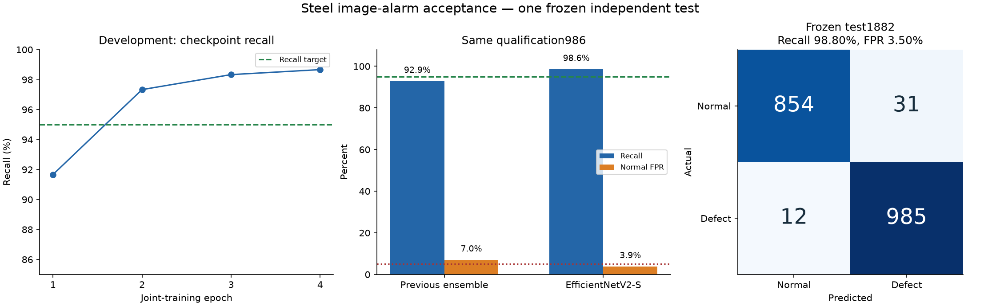

# 钢材检测最终验收 / Frozen steel-inspection acceptance

2026-11-24：**已通过指定图像报警验收 / Specified image-alarm acceptance passed**。最终test1882张，权重与整套阈值在读取test前冻结；未用test选择模型或调整阈值。测试验收只针对同类1600×256钢材图的图像报警，不等于任意相机或精确像素边界的生产验收。

One frozen candidate on the original test1882, with no test-based tuning. Scope is comparable native-resolution steel-image alarms; production-camera and pixel-boundary acceptance remain separate.

## 结果 / Results

| 评估 / Evaluation | 缺陷检出 / TP | 漏检 / FN | 正常误报 / FP | 召回 / Recall | 正常FPR | AUROC |
|---|---:|---:|---:|---:|---:|---:|
| 旧组合资格验证 / Old ensemble qualification | 651/701 | 50 | 20/285 | 92.87% | 7.02% | 0.98345 |
| 新模型资格验证 / New qualification | 691/701 | 10 | 11/285 | 98.57% | 3.86% | 0.99493 |
| 独立最终test / Frozen final test | 985/997 | 12 | 31/885 | 98.80% | 3.50% | 0.99705 |

前两行共用986张验证图（701缺陷/285正常）；最后一行使用从未调参的1882张test（997缺陷/885正常）。验证集已多次用于研究，不作为最终独立证据。95% Wilson区间：test召回[97.91%, 99.31%]，正常FPR[2.48%, 4.93%]。验收标准为用户指定的经验召回≥95%、正常FPR≤5%。

The first two rows are paired on the same reused qualification986. The last row is the untouched test1882. Wilson95% intervals are descriptive uncertainty, not a field guarantee. Acceptance uses the user's empirical recall≥95% and normal-FPR≤5% targets.

## 方法与冻结 / Method and freezing

[官方EfficientNetV2-S](https://docs.pytorch.org/vision/main/models/generated/torchvision.models.efficientnet_v2_s.html) ImageNet1K V1编码器＋轻量U-Net＋图像二分类/四类辅助头。8800张train、BF16、micro4累积4次等效16。任务头先预热，联合训练实际4轮后触发预声明提前验证；保留最多12轮计划的完整恢复状态。开发集连续两轮满足97%召回与0.99 AUROC余量，最终权重来自第4轮。原分辨率与ImageNet归一化保留，未做384中心裁剪；无外部Severstal训练权重。

Use generic ImageNet EfficientNetV2-S with a small U-Net and task heads. Warm heads, then train native images jointly with BF16/effective16. Stop after4 epochs via the predefined two-epoch gate, keeping complete resume state. This is not the original paper's training recipe.

开发500选择checkpoint与推理方式；最终采用四翻转图像logit均值，没有学习额外融合器。400张正常校准图按[NP顺序统计量方法](https://jsb-lab.org/wp-content/uploads/2018/02/ScienceAdvances_eaao1659.full_.pdf)确定阈值：alpha=delta=0.05，升序第388个分数，阈值-0.313957274。初始q95方案的99.14%召回/4.56%FPR已单独归档，随后仅依据正常校准样本做有限样本误报控制；未使用qualification/test标签选择这个顺序统计量。

Choose the normal threshold using rank388/400 with alpha=delta=.05. The NP design assumes a fixed score and independent iid normal calibration data; historical validation/calibration reuse and acquisition shifts limit formal coverage claims. Final acceptance relies on the separate frozen test, not a universal probability guarantee.

像素阈值0.4仅在开发500上按全局Dice选择，分类分数不受其影响。test全局Dice=0.7336，全局IoU=0.5793，平均缺陷图Dice=0.7063，像素召回=73.99%，正常像素FPR=0.152%。掩码不按图像分类门控，仍作为定位辅助。

Output mask threshold0.4 is development-selected only. Test localization is measured separately; raw masks are ungated and remain auxiliary. Numeric defect classes can overlap within an image; per-class test counts are in the JSON report.

## 本机使用与验证 / Local use and verification

中位105.7ms、P95 117.7ms；峰值PyTorch分配210.2MiB。 / Median105.7ms, P95117.7ms; PyTorch peak210.2MiB.

基准为FP32、batch1、5次预热后20次测量，包括内存图像预处理/传输/推理/回传，不含相机、JPEG解码或写盘，不代表产线节拍。

The warmed benchmark excludes JPEG decode, camera and disk writes. User selected local single/batch images. Runtime requires the accepted frozen artifact, checks weights/policy/mask threshold, accepts native PNG/JPEG, and keeps uploads/results on this computer.

模型在本地`runs/steel_efficientnet_v2_s/deployment/model.pt`。通过验收后可运行`.\scripts\run_steel_deployment.ps1`，打开 http://127.0.0.1:8765 ，支持单张/多选、定位图与CSV。也支持`batch_steel_inspection.py`文件夹CLI。打包与真实HTTP/CLI验证见独立报告；照片、缓存和权重不上传GitHub。

The accepted artifact is local, self-contained and requires no original training cache/weights at inference. Code/metrics are versioned; dataset images, caches and fitted model artifacts remain local. See package/service verification reports for end-to-end evidence.

模型SHA256：`df3e8bff400607a5b3b42489e36a590cf056c94ba8bd9ab32ee9b8b53aacb659`。冻结指纹：`eb5af201843abc092914f995afa800a5829df479dc429f9164e9656d989d4db0`。

