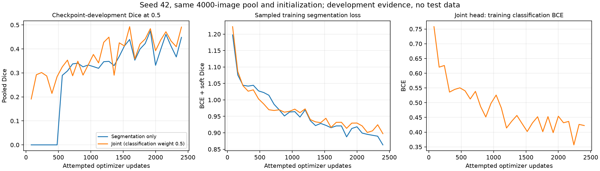

# 显式分类监督对照 / Explicit classification supervision

日期 / Date: 2026-11-23

## 本轮结果 / Results

显式分类监督改善了本轮整图报警，但定位改善很小。以下均为预先指定seed=42、相同200张开发评估图的结果，不是最终测试集成绩。

Explicit supervision improves image alarms in this run, with little localization improvement. All results use predeclared seed 42 and the same 200 development-evaluation images, not the final test set.

| 方法 / Method | Image AUROC | TP/100 | FP/100 | Raw pooled Dice | Raw pooled IoU |
|---|---:|---:|---:|---:|---:|
| 仅分割，最大像素分数 / Segmentation-only, max pixel | 0.7759 | 6 | 5 | 0.5096 | 0.3419 |
| 联合训练，仍取最大像素 / Joint training, max pixel | 0.8163 | 27 | 6 | 0.5124 | 0.3445 |
| 联合训练，分类分支分数 / Joint training, classification head | 0.8801 | 53 | 3 | 0.5124 | 0.3445 |

后两行是同一个联合模型的两种报警分数，共用同一张未经门控的分割图，不能把两行Dice当作两次独立定位实验。AUROC是排序指标，不是准确率。

The final two rows are different alarm scores from one joint model and share the same ungated masks. They are not independent segmentation experiments. AUROC measures ranking, not accuracy.

分类阈值为0.919677（正常校准图q95）。相对原最大像素报警，分类分支新增检出49张原来漏检的缺陷图，同时漏掉2张原来检出的图，净增47张。原5张正常误报均被解除，但另外新增3张正常误报。分类仍漏检47/100，不能部署。

The head threshold is 0.919677 (normal calibration q95). Relative to the original maximum-pixel alarm, the head recovers 49 missed defective images but loses two former detections: net +47. It removes all five old normal false alarms but introduces three different false alarms. It still misses 47/100 defects and is not deployable.

原始正常非空掩码由94/100变成96/100，正常像素误报率由1.16%变成1.55%。因此，整图报警的改善没有解决原始掩码中的背景误检。原始Dice只增加约0.0029，不能称定位精度显著提高。

Raw nonempty normal masks increase from 94/100 to 96/100; normal-pixel FPR rises from 1.16% to 1.55%. Better alarms do not solve background false segmentation. Raw Dice increases by only about 0.0029, without evidence of significant localization improvement.

### 门控的代价 / Gating tradeoff

若分类报警为0便清空掩码，探索性结果如下。此规则不作为默认输出。

Exploratorily suppressing masks on negative classification alarms produces the following tradeoff. It is not the default output.

| 联合模型掩码 / Joint masks | Pooled Dice | Normal nonempty /100 | Normal-pixel FPR | Defect-pixel recall |
|---|---:|---:|---:|---:|
| 原始 / Raw | 0.5124 | 96 | 1.55% | 50.81% |
| 分类门控 / Classification-gated | 0.5414 | 3 | 0.18% | 43.70% |

门控删除184477个原本正确检出的缺陷像素，约占原始真阳性像素的13.99%；45张原本有正确定位像素的缺陷图被分类分支判为阴性。即使总体Dice变高，也不能说漏检问题解决了。

Gating removes 184477 correctly detected defect pixels (13.99% of raw true-positive pixels). Forty-five defective images with some correctly localized pixels receive a negative head decision. Higher aggregate Dice does not mean missed defects are solved.

### 剩余薄弱点 / Remaining weaknesses

| 数字类别 / Numeric class | Evaluation images | Head detections |
|---|---:|---:|
| 1 | 9 | 2 |
| 2 | 6 | 1 |
| 3 | 75 | 48 |
| 4 | 14 | 4 |

类别为多标签重叠分组，不能相加当成独立样本。分类分支在缺陷面积占比0.1%–1%的26张图中只检出6张，在1%–5%的42张中检出25张，在≥5%的32张中检出22张；本评估子集没有面积低于0.1%的缺陷图。不能用总体分数证明极小缺陷性能。

Class groups overlap on multilabel images and cannot be summed as independent samples. The head detects 6/26 images with 0.1%–1% defect area, 25/42 with 1%–5%, and 22/32 with at least 5%. No evaluated defective image has less than 0.1% defect area. Aggregate metrics do not validate extremely small defects.

两组抽样中第2类仅出现215次、第3类7161次（多标签可重叠），说明按正负平衡不等于按缺陷类别平衡。这是下一轮可检验的因素，当前小类别样本太少，不能仅凭此证明因果。

The sampled batches contain class 2 only 215 times versus class 3 7161 times (overlaps allowed). Positive/negative balance is not defect-class balance. This is a testable factor, not causal proof from small class subsets.

建议先在预定seed=43、44复验同一联合方案，确认分类收益的稳定性，再针对小缺陷/稀有类别做分块抽样对照。最终测试集继续保留。

Next repeat the unchanged joint scheme on predefined seeds 43 and 44, then investigate small-defect/rare-class tile sampling. Keep final test data reserved.

## 目的与结构 / Question and architecture

此前最大像素概率报警与分割质量不一致。本轮检验：为共享编码器增加显式“该分块是否含缺陷”的监督，能否改善整图报警，同时保留定位能力。

Previously, maximum-pixel alarms and segmentation quality diverged. This experiment tests whether explicit tile-level defect supervision improves image alarms while preserving localization.

- 保留 ResNet18-U-Net 分割分支。编码器最后一层的空间均值与最大值拼接为1024维，经1024→128→1分类头输出一个分块分数。
- Keep the ResNet18-U-Net segmentation branch. Concatenate spatial mean/max features from the final encoder stage (1024 dimensions), then use a 1024→128→1 classification head.
- 输入仍为256×256原分辨率分块，横向步长128，一张1600×256图片共12块；重叠分割概率平均拼接。整图分类分数取12个分类头 sigmoid 分数的最大值。
- Use 256×256 original-resolution tiles, stride 128, 12 tiles per 1600×256 strip. Average overlapping segmentation probabilities; the image classification score is the maximum of 12 tile-head sigmoid scores.
- 分块掩码含任何缺陷像素时，分类标签为1，否则为0；不把缺陷原图中的正常分块误标为缺陷。仍是四类掩码的二值并集，不输出缺陷类别名称。
- A tile is positive only if its own mask contains defect pixels. Normal tiles from defective parent images stay negative. Segmentation remains the binary union of four numeric classes.

## 公平对照 / Matched controls

两组使用完全相同的联合结构、初始参数、固定4000张训练图、分块抽样及翻转、AdamW、2400次更新预算、严格确定性设置与预先指定种子42。分类头最后初始化，保留原分割初值。唯一预定干预是分类损失权重：0和0.5。

Both groups use identical joint architecture, initial state, fixed 4000-image training pool, tile sampling/flips, AdamW, 2400 attempted updates, strict determinism and predeclared seed 42. Initialize the classification head last to preserve segmentation initialization. The planned intervention is classification-loss weight 0 versus 0.5.

两组参数均为12587538个；仅分割实际完成2400次更新，联合组因AMP溢出跳过3次，实际完成2397次。预算是相同的2400次更新尝试，不应写成实际更新次数完全相同。最佳检查点分别为第24轮和第20轮，每轮80次尝试。

Both models have 12587538 parameters. The control completes 2400 updates; joint training skips three AMP-overflow steps and completes 2397. Budgets match at 2400 attempted updates, not identical successful-update counts. Best checkpoints are rounds 24 and 20 (80 attempts/round).

`L = BCE_seg + soft_Dice_seg + alpha * BCE_classification`

权重0的分类头没有接受分类监督，其随机分数不可作为已训练的分类器宣传。它的目的，是检查新增结构本身是否改变原分割训练。两组仍按原80张开发图的Dice@0.5选择检查点；没有按分类成绩另选检查点。

The weight-zero head receives no classification supervision; its chance scores are not a trained detector. It controls for the added architecture. Both checkpoints are selected using the original 80-image development Dice at 0.5, without separate classification-based checkpoint selection.

像素阈值仍在80张开发图上选择；最大像素报警与分类报警分别在原200张正常校准图上取95%分位阈值。最终比较沿用同一批100正常+100缺陷评估图。校准集、检查点开发集、评估子集互不重叠，全部来自val。1882张test图片继续保留。

Select the pixel threshold on 80 development images. Independently calibrate maximum-pixel and classification alarms at the 95th percentile of the same 200 normal calibration images. Compare on the unchanged 100 normal/100 defective evaluation images. Development, calibration and evaluation identities are disjoint validation subsets; all 1882 test images remain reserved.

## 复现与使用 / Reproduce and use

在项目根目录、已配置好的Python环境中运行。以下命令会重新训练；已有权重时，使用后面的单图命令即可。

Run from the project root in the configured Python environment. The first commands retrain; use the later single-image command when checkpoints already exist.

```powershell
foreach ($clsLossWeight in @(0,0.5)) {
  python scripts/train_steel_unet.py --coverage-balanced --encoder pretrained-resnet18 --expanded --rounds 30 --deterministic --seed 42 --classification-weight $clsLossWeight
  if ($LASTEXITCODE -ne 0) { break }
}
python scripts/analyze_unet.py --coverage-balanced --encoder pretrained-resnet18 --expanded --rounds 30 --deterministic --seed 42 --classification-weight 0.5
python scripts/compare_joint_training.py
python scripts/plot_joint_training.py
```

单图示例使用本地已有数据文件；替换为自己的实际图片路径。相机、材质、光照改变后的效果需要另外验证。

The example uses an existing local dataset image. Replace it with an actual image path. Changes in camera, material or lighting require separate validation.

```powershell
python scripts/train_steel_unet.py --coverage-balanced --encoder pretrained-resnet18 --expanded --rounds 30 --deterministic --seed 42 --classification-weight 0.5 --image data/severstal/034941f9d.jpg
```

权重及输出在 `runs/steel_unet_balanced_pretrained_resnet18_expanded_r30_det_s42_cls0p5/`。终端分别输出原最大像素报警与分类报警；`single_overlay.png`、`single_mask.png`、`single_probability.npy`仍为未经分类门控的定位结果。分类报警为0时，掩码也可能含预测像素，这是两个不同任务的输出。

Weights and outputs are in `runs/steel_unet_balanced_pretrained_resnet18_expanded_r30_det_s42_cls0p5/`. The terminal prints separate maximum-pixel and classification alarms. `single_overlay.png`, `single_mask.png` and `single_probability.npy` remain ungated localization outputs. A negative classification alarm can coexist with predicted mask pixels because the outputs serve different tasks.

上述单图示例实际输出：最大像素报警1、分类报警0，进一步说明分类门控可能清空有定位结果的图片；不能只展示成功例。

The example actually returns maximum-pixel alarm 1 and classification alarm 0, illustrating why gating can suppress an image with localization output. Do not show only successful cases.

## 检查与证据 / Checks and evidence

38项单元测试通过，包括原分割初值/前向保持一致、两分支梯度和零分类权重梯度检查。严格确定性GPU联合前后向通过，两组检查点重新加载后的一张评估图分割最大值和分类分数均与记录一致（容差1e-5）。这不是全部图片的跨平台复现保证。

All 38 unit tests pass, including segmentation initialization/forward preservation, joint gradients and zero-weight head gradients. Strict deterministic GPU forward/backward succeeds. Reloaded checkpoints reproduce the recorded segmentation maximum and head score on one evaluation image per model (tolerance 1e-5), not an all-image or cross-platform guarantee.

权重0对照的全部30轮训练损失/开发Dice记录、最佳分割参数及缓冲区哈希、分割指标与历史seed=42实验完全一致。新增分类头不改变该对照的分割轨迹。联合两组的初始完整状态哈希、样本身份、类别抽样计数及确定性配置也均核对一致。

The zero-weight control exactly reproduces all 30 historical seed-42 training-loss/development-Dice records, best segmentation parameter/buffer hash and segmentation metrics. The added head preserves that control trajectory. Joint initial-state hashes, identities, class-sampling counts and deterministic settings also match.

原始数值与审计结果：[对照汇总 / Comparison](steel_joint_comparison.json)、[仅分割 / Segmentation control](steel_unet_balanced_pretrained_resnet18_expanded_r30_det_s42_cls0_metrics.json)、[联合模型 / Joint model](steel_unet_balanced_pretrained_resnet18_expanded_r30_det_s42_cls0p5_metrics.json)。定位诊断仍按最大像素报警统计；分类诊断见对照汇总的独立字段，两者不可混用。

Numerical artifacts are linked above. The segmentation diagnosis uses maximum-pixel alarms; separate classification diagnosis is in the comparison JSON. Do not mix their recall fields.



## 限制 / Limits

本轮只有一个预定种子，且同一开发评估集已经用于多个阶段的比较，不能视为最终独立测试，也不能由一次结果推断统计显著提升。此前三种子的波动仍需要重视。

This is one predeclared seed on a development evaluation set reused across stages, not independent final testing or evidence of statistical significance. Earlier three-seed variation remains relevant.

训练按4正+4负分块抽样，不等于实际产线缺陷发生率。sigmoid分数不是经过概率校准的真实缺陷概率；正常校准集5%尾部分位也不保证其他数据的误报率恰好5%。编码器最后特征图的下采样，以及小缺陷分块的判别难度，是后续可检验因素，不是本轮已证明的失败原因。

Training samples four positive/four negative tiles per batch, unlike production prevalence. Sigmoid scores are not calibrated real-world defect probabilities, and a calibration-tail threshold does not guarantee 5% false alarms elsewhere. Encoder downsampling and tiny-defect tile difficulty are hypotheses for later testing, not established causes here.

默认不使用分类门控清空掩码。报告中的门控结果仅作探索性对照：它会同时抑制误报和真实缺陷，必须同时看Dice与召回，不能只报正常图更干净。

Classification gating is not the default. Exploratory gated-mask results suppress both false positives and real defects; assess Dice and recall together instead of reporting cleaner normal images alone.
