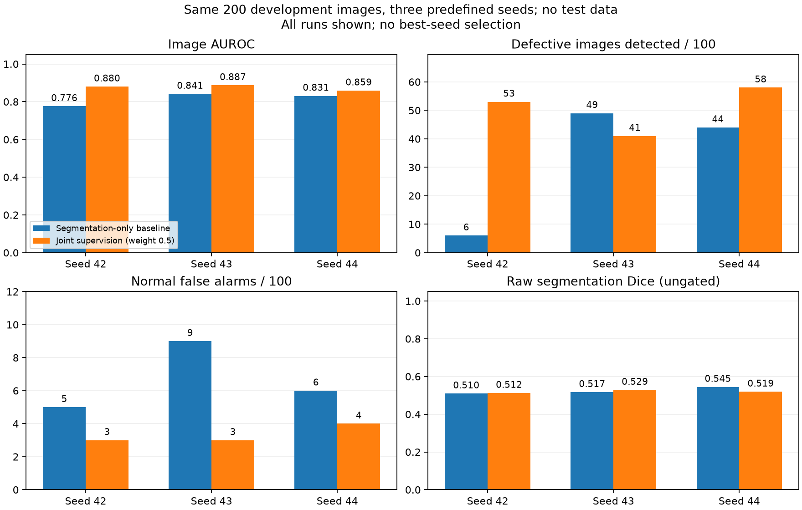

# 联合模型三种子复验 / Joint-model three-seed replication

日期 / Date: 2026-11-23

后续已完成seed=42分块抽样对照，见[小缺陷与稀有类别抽样 / Sampling follow-up](tile_sampling_experiments.md)。本页保留原联合方案的三种子结果。

The seed-42 sampling follow-up is complete; see the linked report. This page preserves the original joint scheme's three-seed results.

## 结果与结论 / Results and interpretation

三个种子的分类AUROC均高于对应分割基线，正常误报也均减少；但当前报警阈值下的召回并非都提高，分割Dice均值略降。此结果支持保留显式分类分支继续研究，不能称检测和定位均已稳定解决。

Classification AUROC improves and normal false alarms decrease in all three paired seeds. Recall at the current thresholds does not improve uniformly, and mean raw Dice slightly decreases. Keep the explicit head as a research direction; detection and localization are not solved.

| Seed | Baseline AUROC | Joint-head AUROC | TP/100 baseline → head | FP/100 baseline → head | Raw Dice baseline → joint |
|---|---:|---:|---:|---:|---:|
| 42 | 0.7759 | 0.8801 | 6 → 53 | 5 → 3 | 0.5096 → 0.5124 |
| 43 | 0.8413 | 0.8868 | 49 → 41 | 9 → 3 | 0.5168 → 0.5287 |
| 44 | 0.8310 | 0.8590 | 44 → 58 | 6 → 4 | 0.5446 → 0.5193 |

均值 ± 样本标准差（ddof=1，3个种子），不是置信区间 / Mean ± sample SD (ddof=1, three seeds), not confidence intervals:

| 指标 / Metric | Baseline | Joint |
|---|---:|---:|
| Image AUROC | 0.8161 ± 0.0352 | 0.8753 ± 0.0145 |
| Image recall | 33.00% ± 23.52% | 50.67% ± 8.74% |
| Normal image FPR | 6.67% ± 2.08% | 3.33% ± 0.58% |
| Raw pooled Dice | 0.5237 ± 0.0185 | 0.5201 ± 0.0081 |
| Normal-pixel FPR | 1.42% ± 0.32% | 1.57% ± 0.16% |

新复验43、44的AUROC分别增加0.0455、0.0280，但检出数分别变化−8、+14。seed=43更少误报也更少检出，是具体工作点的权衡，不能只用AUROC代表召回。原始掩码正常像素误报均值反而略升，说明分类分支没有修复背景分割。

New replication seeds 43/44 gain 0.0455/0.0280 AUROC but change detections by −8/+14. Seed 43 trades fewer detections for fewer false alarms at the chosen operating point. AUROC is not recall. Mean normal-pixel FPR slightly rises, so classification does not fix background segmentation.

## 持续漏检与小缺陷 / Persistent misses and small defects

| 报警次数 / Alarmed in this many seeds | Baseline defective images | Joint-head defective images |
|---|---:|---:|
| 0/3 | 46 | 29 |
| 1/3 | 13 | 21 |
| 2/3 | 37 | 19 |
| 3/3 | 4 | 31 |

这是跨训练种子的诊断分布，不是投票检测器成绩。联合分支仍有29张缺陷图三个种子全部漏检；其中面积0.1%–1%的15张、1%–5%的9张、≥5%的5张。原基线的小面积持续漏检同样为15张，说明现有收益没有消除这组持续失败样本。

This is a cross-training-seed diagnostic distribution, not a voting detector's score. Twenty-nine defective images are missed by every joint head: 15 with 0.1%–1% defect area, nine with 1%–5%, five with at least 5%. The baseline also persistently misses 15 small-area images, so current gains do not eliminate that persistent subgroup.

| 分组 / Group | Images | Head TP seed42 | Head TP seed43 | Head TP seed44 |
|---|---:|---:|---:|---:|
| Class 1 | 9 | 2 | 1 | 3 |
| Class 2 | 6 | 1 | 1 | 2 |
| Class 3 | 75 | 48 | 34 | 49 |
| Class 4 | 14 | 4 | 5 | 7 |
| Defect area 0.1%–1% | 26 | 6 | 3 | 7 |
| Defect area 1%–5% | 42 | 25 | 24 | 25 |
| Defect area ≥5% | 32 | 22 | 14 | 26 |

类别分组有重叠，不可相加。上述小面积是整张图的缺陷面积占比，不是裂纹宽度或绝对像素尺寸。下一步优先做稀有类别/小缺陷分块抽样的受控对照，保持联合结构、损失权重、验证规则及预先指定seed=42不变，不按本轮结果改选最好种子。

Class groups overlap and must not be summed. Small area refers to whole-image defect-area fraction, not crack width or an absolute pixel size. Next test rare-class/small-defect tile sampling with the joint architecture, loss weight, validation rules and predeclared follow-up seed 42 fixed; do not switch to the best seed.

## 分类门控的代价 / Classification-gating tradeoff

| Seed | Raw Dice | Gated Dice | Raw defect-pixel recall | Gated defect-pixel recall | Raw TP pixels removed |
|---|---:|---:|---:|---:|---:|
| 42 | 0.5124 | 0.5414 | 50.81% | 43.70% | 13.99% |
| 43 | 0.5287 | 0.3632 | 53.05% | 24.66% | 53.51% |
| 44 | 0.5193 | 0.5510 | 48.76% | 44.36% | 9.03% |

门控令正常非空掩码从96/89/91张降至3/3/4张，但三个种子的缺陷像素召回都下降；seed=43损失超过一半原本正确定位的像素。默认继续输出未经门控的掩码，分类报警单独显示，不将正常图更干净当成整体改进。

Gating reduces nonempty normal masks from 96/89/91 to 3/3/4, but defect-pixel recall falls in every seed. Seed 43 loses over half its originally correct defect pixels. Keep raw masks by default and show classification alarms separately; cleaner normal images alone are not overall improvement.

| Seed | Best round | Attempted updates | Completed updates | AMP skips | Head q95 threshold |
|---|---:|---:|---:|---:|---:|
| 42 | 20 | 2400 | 2397 | 3 | 0.919677 |
| 43 | 25 | 2400 | 2396 | 4 | 0.982966 |
| 44 | 19 | 2400 | 2397 | 3 | 0.796520 |

三个历史基线均完成2400次实际更新。分类分数尺度随训练变化，不能把某个种子的阈值直接复制给另一个种子。

All historical baselines complete 2400 successful updates. Head score scales vary by training; do not copy one seed's threshold to another model.



## 方案与对照 / Protocol and controls

沿用上阶段确定的联合方案，不调整模型、分类损失权重0.5、优化器、采样或阈值规则。已有seed=42结果保留，本轮新增训练seed=43、44；三个种子全部报告，不挑最好的一次，也不融合三个模型作为新检测器。

Keep the previous joint architecture, classification-loss weight 0.5, optimizer, sampling and threshold rules unchanged. Reuse seed 42 and newly train seeds 43/44. Report all three without best-seed selection or deploying a new ensemble.

固定4000张训练图（2000正常/2000缺陷），256×256原分辨率分块、横向步长128。每轮80次更新尝试，每次训练30轮，共2400次尝试。每批4个正分块+4个负分块、水平/垂直翻转，AdamW lr=0.001。严格确定性设置与原实验一致。

Use the fixed 4000-image pool (2000 normal/2000 defective), original-resolution 256×256 tiles with stride 128, 30 rounds of 80 attempted updates (2400 total), four positive/four negative tiles per batch, flips and AdamW lr=0.001. Strict deterministic settings match the earlier experiments.

检查点仍按同一80张开发图的Dice@0.5选取；像素阈值在这80张上选择。整图分类分数取12块分类头分数最大值，报警阈值在同一200张正常校准图上取q95。所有方法均评估同一100正常+100缺陷图；开发、校准和评估身份互不重叠，均来自val。最终1882张test图片未使用。

Select checkpoints by Dice at 0.5 on the same 80 development images and pixel thresholds on those images. Image classification takes the maximum of 12 tile-head scores, with q95 thresholds from the same 200 normal calibration images. Every method uses the same 100 normal/100 defective evaluation images. Development, calibration and evaluation identities are disjoint validation subsets. All 1882 final test images remain unused.

43、44的参照使用此前已完成的分割基线，而不是本轮再训练结构完全相同、分类权重0的模型；只有seed=42做过严格同结构权重0对照。本轮逐种子核对：新增分类头前后的分割初始参数/缓冲区哈希与历史一致，训练/开发/校准/评估清单一致，正负分块数量、各类实际抽样次数、优化器和确定性配置一致。

Seeds 43/44 reuse historical segmentation baselines instead of newly training identical joint architectures with zero classification weight; the exact same-architecture zero-weight control exists only for seed 42. For every seed, audit matching historical segmentation initialization hashes, all image selections, tile counts, actual class draws, optimizer and deterministic settings.

每个联合检查点的模型哈希、数据清单哈希、分类阈值和保存元数据均核对；重新加载后的一张评估图，分割最大值及分类分数与记录一致（容差1e-5）。CSV报警标签和AUROC独立重算核对。38项单元测试通过。没有声称全部图片的逐位跨进程、跨硬件复现。

Audit each joint checkpoint's model/manifest hashes, threshold and metadata. Reloaded segmentation maximum/head scores match recorded values on one evaluation image per model (tolerance 1e-5). Recompute CSV alarm labels and AUROC. All 38 unit tests pass. This is not an all-image bitwise cross-process or cross-hardware guarantee.

## 复现与文件 / Reproduce and artifacts

以下训练命令会重新训练对应种子；已有本地结果时直接运行汇总与绘图命令即可。先前seed=42的联合结果是本轮汇总的必要输入。

Training commands rerun the named seeds. With local artifacts already present, run only summary/plot commands. The existing joint seed-42 run is also required.

```powershell
foreach ($trainingSeed in @(43,44)) {
  python scripts/train_steel_unet.py --coverage-balanced --encoder pretrained-resnet18 --expanded --rounds 30 --deterministic --seed $trainingSeed --classification-weight 0.5
  if ($LASTEXITCODE -ne 0) { break }
  python scripts/analyze_unet.py --coverage-balanced --encoder pretrained-resnet18 --expanded --rounds 30 --deterministic --seed $trainingSeed --classification-weight 0.5
  if ($LASTEXITCODE -ne 0) { break }
}
python scripts/summarize_joint_multiseed.py --initialization-only
python scripts/summarize_joint_multiseed.py
python scripts/plot_joint_multiseed.py
```

汇总与完整核对结果见 [steel_joint_multiseed.json](steel_joint_multiseed.json)。各模型在 `runs/steel_unet_balanced_pretrained_resnet18_expanded_r30_det_s{seed}_cls0p5/`，保留best.pt、训练历史及逐图预测CSV。权重和数据集照片仅保留本机；版本库保存选择清单、数值、代码与不含数据照片的图表。

See the linked JSON for full audit/results. Local model directories retain best.pt, histories and per-image prediction CSVs. Weights/dataset photographs stay local; selections, numerical reports, code and plots without dataset photographs are versioned.

## 解读边界 / Interpretation limits

三次共用200张评估图，不是600个独立样本。均值与样本标准差只描述三个训练种子的变化，不是新产线数据的置信区间，也不能证明统计显著性。seed=42此前已促成复验，因此不是本轮新增的独立验证。开发评估图在多阶段被反复查看，结果不是最终独立测试。

Runs share 200 evaluation images, not 600 independent samples. Mean/sample SD describe three training seeds, not production-data confidence intervals or statistical significance. Seed 42 motivated this replication and is not a new independent confirmation. Repeated development-set inspection prevents treating these results as final independent testing.

不同种子的正常分位数阈值可以不同；q95不保证评估图误报恰好5%。各轮是有放回抽样更新，不是遍历全部数据的epoch；AMP溢出跳过次数单独报告，2400是尝试次数。

Normal-quantile thresholds may differ by seed; q95 does not guarantee 5% evaluation false alarms. Rounds sample with replacement rather than exhaustive dataset epochs. Report AMP-overflow skips separately: 2400 is the attempted-update budget.

原始定位图始终不按分类报警清空。门控仅作探索分析，必须同时报告正常掩码和缺陷像素召回。四类分组允许重叠，不把数字ID擅自命名为某种缺陷。小类别样本少；本评估子集没有面积占比<0.1%的缺陷图，不能宣称已验证极小缺陷。

Default localization remains ungated. Exploratory gating must report normal masks and defect-pixel recall together. Numeric class groups overlap and are not assigned unverified defect names. Rare-class samples are small, and no evaluated defective image has under 0.1% defect area; extremely small defects are not validated.
