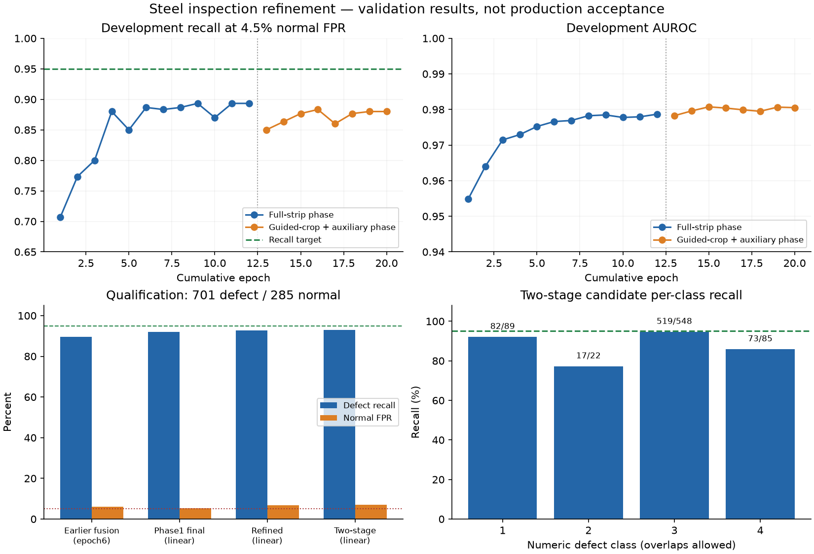

# 全幅钢材检测训练与验证 / Full-strip training and validation

2026-11-24：已从昨天第2轮50批的断点恢复，完成第二阶段全部8轮训练及推理验证。**尚未达到缺陷召回≥95%、正常误报≤5%的部署门槛，未解锁最终test，未生成验收通过的部署包。**

Resumed from epoch2/batch50 and completed all eight refinement epochs. **The recall≥95% / normal-FPR≤5% target remains unmet. Final test is locked; no accepted deployment package was created.**

## 训练与数据 / Training and data

全部8800张train图，原始1600×256分辨率。第一阶段12轮全幅训练；第二阶段8轮，50%批次使用保留缺陷的原尺度800宽裁剪，增加四类辅助监督、每步分割监督，EMA选择模型。第二阶段累计4400次更新尝试，2次AMP溢出跳过；正常结束，最佳开发检查点来自第4轮。第2轮训练loss仅统计恢复后的剩余批次，开发评估仍覆盖全部500张。

Use all8800 train images at native resolution. Phase1 runs12 full-strip epochs. Refinement runs8 epochs with guided800 crops in half the batches, four-class auxiliaries, denser mask supervision and EMA. There are4400 update attempts and2 recorded AMP skips; training terminates normally. Best refinement development checkpoint is epoch4. Epoch2 training loss covers only resumed batches; evaluation still covers all500 development images.

开发500张（200正常/300缺陷）用于模型与5折OOF元分类器选择；400张正常图用于阈值校准；986张qualification（285正常/701缺陷）用于重复的验证实验。1882张原test未使用。qualification已用于研究迭代，不能作为完全独立的最终泛化证据。

Development500 selects checkpoints and five-fold OOF fusion policies. Separate400 normals calibrate thresholds. Qualification986 contains285 normals and701 defective images. It is reused validation, not an independent final generalization claim. The original1882 test images remain unused.

## 结果 / Results

以下三组均使用相同qualification图片。模型、融合方式与阈值由开发/校准数据决定；不按qualification标签选择阈值。

All three rows use the same qualification images. Operating policies are selected using development/calibration, not qualification labels.

| 候选 / Candidate | AUROC | 缺陷检出 / TP | 漏检 / FN | 正常误报 / FP | 召回 / Recall | 正常FPR |
|---|---:|---:|---:|---:|---:|---:|
| 第一阶段最终模型＋线性融合 / Phase1 final + linear | 0.98325 | 645/701 | 56 | 15/285 | 92.01% | 5.26% |
| 第二阶段＋线性融合 / Refined + linear | 0.98279 | 650/701 | 51 | 19/285 | 92.72% | 6.67% |
| 两阶段组合＋线性融合 / Two-stage linear ensemble | 0.98345 | 651/701 | 50 | 20/285 | 92.87% | 7.02% |

组合候选开发OOF召回94.0%，高于两单模型线性候选的91.67%/92.67%，因此保留为当前研究候选，**不能把它当作验收通过模型**。分类2为17/22、分类4为73/85；类别可重叠，不能将各类样本数相加作为独立图片数。

The ensemble has development-OOF recall94.0%, versus91.67%/92.67% for the two linear single-stage candidates, and remains the current research candidate. **It is not accepted for deployment.** It detects17/22 class2 and73/85 class4 images; numeric defect classes can overlap.

仅作诊断、未采用的qualification ROC点：组合候选在14/285正常误报（4.91%）时检出649/701（92.58%）。因此本候选无法只通过阈值移动同时达到目标；这不是可用于上线的新阈值，也不是新独立测试。

Diagnostic only: at14/285 normal false alarms (4.91%), ensemble recall is649/701 (92.58%). This point is not applied to the frozen policy. Threshold movement alone cannot meet both targets for this candidate on these validation images.

## 对照与限制 / Controls and limits

- 训练图BN统计重估：两阶段均未改善开发集结果，未采用。参数本身保持不变，重估过程只读8800张train。
- 非线性RBF融合：第二阶段OOF召回93.67%，qualification仅89.73%召回/6.67%FPR；第一阶段为87.73%/4.56%。复杂度增加没有稳定收益，失败结果完整保留于对应`*_svm_qualification.json`。
- 线性对照复用同一模型哈希、相同图片顺序的缓存特征，未重新训练网络。三窗口、四类辅助信息都纳入开发比较，但最终组合选择两模型的掩码/整图特征，没有选择窗口或类别辅助特征。

Train-only BN recalibration fails to improve either stage and is rejected. RBF fusion looks better in development but falls to89.73% recall/6.67% FPR for refinement and87.73%/4.56% for phase1 on qualification; failure reports are retained. Linear comparisons reuse checkpoint-bound, ID-verified features. Window and class features are evaluated, but the selected ensemble uses only whole-image/mask features from each member.

定位使用第二阶段的原始、无分类门控掩码，固定像素阈值0.5。同一qualification上平均缺陷图Dice从第一阶段0.60424到0.62618；全局Dice0.61658、像素召回60.25%、正常像素FPR1.736%。定位效果仍有限，图像级报警目标不代表像素级定位验收。

Localization retains the refined member's raw ungated mask at threshold0.5. On the same qualification set, mean defective-image Dice improves from0.60424 to0.62618. Global Dice is0.61658, pixel recall60.25%, normal-pixel FPR1.736%. Localization remains limited and is separate from image-alarm acceptance.

## 本机验证 / Local verification

62项测试通过。独立CLI进程重载一张正常/一张缺陷开发图，分数相对批量验证最大误差5.83e-7，输出1600×256热力图、二值掩码和浮点分数图均通过检查。

All62 tests pass. Independent CLI reload on one normal/one defective development image reproduces batch scores within5.83e-7; full-resolution overlays, binary masks and finite probability maps pass checks.

RTX5060 Laptop、FP32、batch1，预热5次后测20次：完整内存RGB预处理、GPU推理和结果回传中位123.9ms、P95 148.0ms，PyTorch峰值分配360.4MiB；不含JPEG解码、相机和写盘，单开发图基准，不是现场吞吐承诺。

RTX5060 Laptop, FP32/batch1, five warmups and20 measurements: median123.9ms, P95 148.0ms, peak PyTorch allocation360.4MiB. This includes in-memory preprocessing, inference and CPU return, excluding JPEG decode, camera and disk writes; one development image, not production throughput.

研究候选在本地`runs/strip_inspector_ensemble/candidate.pt`，两阶段原权重和完整续训断点均保留。GitHub只保存代码、数值、协议和说明，融合参数也随本地候选保存；数据、缓存、模型权重不上传。

The local self-contained research artifact is `runs/strip_inspector_ensemble/candidate.pt`. Both source checkpoints and complete resume state are retained. GitHub stores source, metrics, protocol and docs; fitted fusion parameters remain with local artifacts, along with datasets/caches/weights.

```powershell
# 项目根目录，试验检测；不是验收通过的部署入口 / Experimental inference at project root
& 'C:\Users\yzdys\miniconda3\envs\py312\python.exe' scripts/inspect_steel_strip.py --model runs/strip_inspector_ensemble/candidate.pt --image data/severstal/61be1f51b.jpg --output-dir runs/strip_inspector_ensemble/demo
```

下一阶段应针对共同漏检和误报图检查特征不足，再评估更强的领域适配编码器；继续固定数据划分和封存test。新模型训练、最终test和真实相机验收本轮均未完成，不能写成已部署。

Next investigate shared misses/false alarms and stronger domain feature extraction, preserving the split and locked test. New-backbone training, final-test acceptance and production-camera validation have not been completed in this run.


