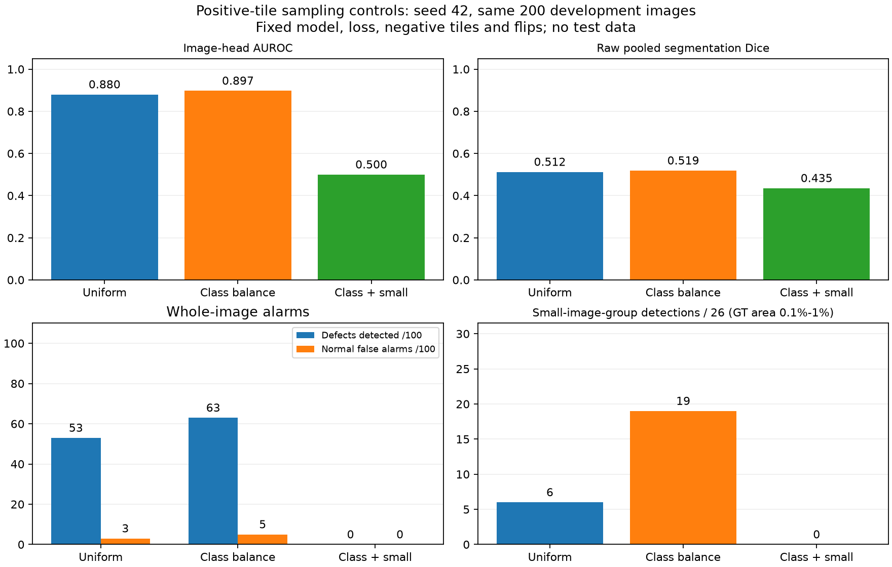

# 小缺陷与稀有类别分块抽样 / Small-defect and rare-class tile sampling

日期 / Date: 2026-11-23

## 本轮结果 / Results

类别平衡改善了本轮的小面积缺陷和稀有类别检出，但增加了误报；额外的强小分块偏采样失败。以下均为seed=42、同一200张开发评估图，不能当成独立最终测试或统计显著提升。

Class balancing improves small-area and rare-class detections in this run, with more false alarms. Adding strong small-tile preference fails. Results use seed 42 and the same 200 development images, not independent final testing or proof of significance.

| Sampling | Head AUROC | TP/100 | FP/100 | Raw Dice | Small-area head TP/26 | Class-2 head TP/6 |
|---|---:|---:|---:|---:|---:|---:|
| Uniform | 0.8801 | 53 | 3 | 0.5124 | 6 | 1 |
| Class balance | 0.8975 | 63 | 5 | 0.5188 | 19 | 4 |
| Class + small | 0.5000 | 0 | 0 | 0.4353 | 0 | 0 |

“Class + small”的0误报来自分类分数退化为常数、所有图片都不报警，不是可靠性提高。原始定位图仍有输出，不能把分类失败误写成分割图也全部为空。

Zero false alarms in the small-preference arm come from constant scores and no alarms on any image, not greater reliability. Raw masks still exist; classification failure does not mean all segmentation masks are empty.

### 改善与代价 / Gains and tradeoffs

| 指标 / Metric | Uniform | Class balance | Class + small |
|---|---:|---:|---:|
| Normal-pixel FPR | 1.55% | 2.02% | 3.18% |
| Nonempty normal masks /100 | 96 | 74 | 94 |
| Small-area defect-pixel recall (0.1%–1% image group) | 65.95% | 77.39% | 62.96% |
| Class-1 pixel recall | 33.64% | 69.46% | 39.75% |
| Class-2 pixel recall | 34.98% | 73.18% | 64.56% |
| Class-3 pixel recall | 58.24% | 54.35% | 44.49% |
| Class-4 pixel recall | 24.64% | 55.32% | 48.96% |

像素召回来自不经门控的二值并集图；类别分组有重叠。类别平衡让0.1%–1%组检出由6/26到19/26，1%–5%组仍25/42，≥5%组则由22/32降到19/32。正常非空掩码虽减少，正常误报像素总量反而增加，不能只用“正常图更干净”描述结果。

Pixel recall uses ungated binary-union masks; class groups overlap. Class balance raises small-area detections from 6/26 to 19/26, keeps medium-area detections at 25/42, but lowers the ≥5% group from 22/32 to 19/32. Fewer nonempty normal masks coexist with more false-positive pixels overall; masks are not uniformly cleaner.

类别2只有6张评估图，改善需复验。类别平衡候选仍漏检37/100，原始Dice仅小幅增加0.0064，尚不可部署。下一步先对类别平衡方案进行预定seed=43、44复验，保持本轮抽样规则，不能由这一次结果断言新方法普遍更好。

Only six evaluation images contain class 2, so replicate the gain. The class-balanced candidate still misses 37/100 and gains only about 0.0064 raw Dice; it is not deployable. Next repeat the unchanged class-balanced policy on predefined seeds 43/44 before drawing broader conclusions.

### 分类头退化的直接证据 / Direct evidence of head collapse

小分块组全部200张评估图的分类分数均为0.4998937547（标准差0），正常q95阈值也为同值；严格大于阈值才报警，所以检出与误报均为0。最后一轮分类BCE约0.693147，分割分支仍在更新。

All 200 small-arm image scores equal 0.4998937547 (SD zero), identical to the normal q95 threshold. Strict greater-than alarms therefore yield zero detections/false alarms. Final classification BCE is about 0.693147 while segmentation still updates.

固定取评估清单中前10张正常+前10张缺陷图，共240个分块，检查同一批输入的分类头：

Inspect the same fixed first ten normal/ten defective evaluation images (240 tiles):

| Saved head observation | Uniform | Class balance | Class + small |
|---|---:|---:|---:|
| All-zero ReLU hidden rows /240 | 0 | 0 | 240 |
| Ever-active hidden units /128 | 8 | 8 | 0 |
| Maximum pre-ReLU activation | 82.2934 | 117.5368 | −0.3538 |

小分块组在这些输入上的128维隐层全部被ReLU截成0，末层权重仍非零，输出只剩偏置；sigmoid(偏置)=0.4998937547，正好对应记录中的常数分数。这确认了已保存模型在这些输入上的直接故障，不能仅靠改报警阈值恢复排序。没有逐步保存训练激活，不能证明何时、为什么进入该状态，更不能把所有小缺陷重采样概括为无效。

On these inputs, ReLU zeros every small-arm hidden unit. Final weights remain nonzero, but only the bias contributes: sigmoid(bias)=0.4998937547, exactly matching the constant scores. This identifies the saved model's immediate failure on the inspected inputs; threshold changes cannot recover lost ranking. No stepwise training activations were recorded, so when/why collapse arose is unproven, and this does not invalidate all small-defect resampling.

检查脚本与完整数值：[head diagnosis](steel_sampling_head_diagnosis.json)。三个检查点重新加载后的分数与原CSV记录一致，排除了这次检查加载了不同权重的情况。

The linked head diagnosis contains full observations. Reloaded scores agree with original CSV records for the inspected inputs, confirming the inspected checkpoints reproduce the recorded behavior.

### 实际抽样覆盖 / Actual exposure

| Positive-tile exposure (9600 draws) | Uniform | Class balance | Class + small |
|---|---:|---:|---:|
| Class 1 draws | 1162 | 2739 | 2747 |
| Class 2 draws | 215 | 2463 | 2429 |
| Class 3 draws | 7161 | 2802 | 2645 |
| Class 4 draws | 1255 | 2446 | 2424 |
| Small draws | 644 (6.71%) | 624 (6.50%) | 3974 (41.40%) |
| Unique positive tiles | 6042 | 4275 | 3211 |
| Unique positive parent images | 1892 | 1625 | 1469 |

多标签类别次数可重叠，不能相加当成总抽样数。Uniform暴露次数由已保存训练分块索引回放，并与历史各类实际计数核对；新两组的次数及唯一分块/原图数与训练记录完全一致。负分块及翻转全序列哈希三组一致，供给不足保护在小分块组实际启用，类别2未被强行重复那两个小分块。

Class exposures overlap on multilabel tiles. Uniform exposure is replayed from the saved training index and checked against historical class counts; new-arm counts/unique coverage exactly match training records. All three negative/flip sequence hashes match. The small-arm supply guard is active, so class 2 is not forced to repeatedly use its two small tiles.

三组最佳轮次20/29/30，实际更新2397/2396/2397，AMP分别跳过3/4/3次。2400是相同尝试预算，不是相同成功更新次数。

Best rounds are 20/29/30; completed updates are 2397/2396/2397 with AMP skips 3/4/3. Budgets match at 2400 attempts, not identical successful-update counts.



## 目的与方案 / Question and protocol

此前联合模型三种子仍持续漏检29张缺陷图，其中15张属于整图缺陷面积0.1%–1%的组。正负分块平衡没有消除类别不平衡。本轮固定seed=42和原联合模型，通过两个顺序对照，检查改变正分块分布能否改善这些问题。

The previous joint seeds persistently missed 29 defective images, including 15 in the 0.1%–1% whole-image defect-area group. Positive/negative tile balance did not balance defect classes. Freeze seed 42 and the joint model, then use two sequential positive-sampling interventions.

三组共用原4000张训练图、80张检查点开发图、200张正常校准图及200张开发评估图（100正常/100缺陷）。256×256分块、步长128、分类损失权重0.5、模型初始状态、AdamW及2400次更新尝试预算一致。检查点按开发Dice@0.5选择，像素阈值仍在80张开发图上确定，分类报警阈值仍取正常校准分数q95。1882张最终test图片未使用。

All arms share 4000 training, 80 checkpoint-development, 200 normal calibration and 200 evaluation images (100 normal/100 defective). Keep 256×256 tiles, stride 128, classification-loss weight 0.5, initial state, AdamW and 2400 attempted updates fixed. Select checkpoints by development Dice at 0.5, pixel thresholds on the same development set and head thresholds by normal calibration q95. All 1882 final test images stay unused.

| 抽样组 / Arm | 每批4个正分块 / Four positive tiles per batch |
|---|---|
| Uniform | 原方案：从全部正分块均匀有放回抽取 / Existing uniform-with-replacement baseline |
| Class balance | 分别抽一个含类别1、2、3、4的正分块 / One tile containing each numeric class |
| Class + small | 保持四个类别槽位；合格类别每次有50%概率先进入小分块池，否则进入该类全正分块池 / Same class slots; eligible classes choose a small pool with 50% probability, otherwise the full class pool |

多标签分块允许属于多个池，也允许同批重复，这是有放回抽样。分类及分割仍输出缺陷二值并集，不变成四分类模型。小分块定义为分块内并集缺陷像素1–655个，≤分块面积的1%；不等于整图缺陷面积组，也不保证覆盖完整缺陷实例。全正分块池本身也含小分块，因此50%是偏好池选择概率，不是全局最终小分块占比。

Multilabel tiles can belong to multiple pools and repeated tiles in a batch are allowed. Outputs remain binary defect unions, not a four-class classifier. Small tiles contain 1–655 union-mask defect pixels (at most 1% of tile area), distinct from image-area groups; they can be partial defects at tile boundaries. The full pool also contains small tiles, so 50% is a pool-selection preference, not the final global small-tile fraction.

## 训练池供给与保护 / Train inventory and safeguards

| Numeric class | Positive tiles | Small tiles | Small parent images | Small preference eligible |
|---|---:|---:|---:|---|
| 1 | 1120 | 150 | 98 | Yes |
| 2 | 242 | 2 | 2 | No |
| 3 | 7135 | 414 | 331 | Yes |
| 4 | 1240 | 65 | 59 | Yes |

供给检查发现类别2只有2个小分块、来自2张图。在小分块组训练前，依据训练池加入最低20个小分块且来自至少10张原图的门槛；不足时回退到同类别全正分块池，不反复将这2块作为主要训练来源。没有查看小分块组评估结果后修改该规则。类别平衡组不使用小分块偏好，门槛不影响它的抽样序列。

Train inventory reveals just two small class-2 tiles from two parents. Before small-preference training, require at least 20 small tiles from at least ten parents; otherwise fall back to the same class's full positive pool. This avoids making those two tiles a dominant source. The guard is based on training supply, not small-arm evaluation outcomes, and does not affect the class-only arm.

固定方案见 [protocol JSON](../configs/steel_tile_sampling_protocol.json)。每次仍是4正+4负。先消费原均匀抽样的正分块随机数，再用独立随机流替换正分块，使负分块ID及水平/垂直翻转的序列与原基线一致。完整训练用序列哈希核对；模型、损失或阈值规则没有为某组另行调整。

See the fixed protocol JSON. Batches remain four positive/four negative. Consume the original positive RNG draws, then replace positives using a separate RNG, preserving negative tile IDs and horizontal/vertical flips. Audit full-run sequence hashes; no arm-specific model, loss or threshold-rule changes.

## 复现 / Reproduce

以下命令会重新训练。已有本地结果时直接运行比较与绘图即可。原Uniform完整结果保留；改代码后只重跑其前80步核对，不将其描述为再次完整训练2400步。

The commands retrain. With artifacts present, run comparison/plot only. Reuse the historical full uniform run and replay only its first 80 steps after integration; this is not a second full 2400-step baseline training.

```powershell
python scripts/train_steel_unet.py --coverage-balanced --encoder pretrained-resnet18 --expanded --rounds 1 --deterministic --seed 42 --classification-weight 0.5
python scripts/check_sampling_prefix.py
foreach ($samplingPolicy in @('class-balanced','class-small')) {
  python scripts/train_steel_unet.py --coverage-balanced --encoder pretrained-resnet18 --expanded --rounds 30 --deterministic --seed 42 --classification-weight 0.5 --tile-sampling $samplingPolicy
  if ($LASTEXITCODE -ne 0) { break }
  python scripts/analyze_unet.py --coverage-balanced --encoder pretrained-resnet18 --expanded --rounds 30 --deterministic --seed 42 --classification-weight 0.5 --tile-sampling $samplingPolicy
  if ($LASTEXITCODE -ne 0) { break }
}
python scripts/compare_tile_sampling.py
python scripts/diagnose_sampling_heads.py
python scripts/plot_tile_sampling.py
```

输出分别在 `runs/steel_unet_balanced_pretrained_resnet18_expanded_r30_det_s42_cls0p5_tile_class_balanced/` 和结尾为 `_tile_class_small/` 的目录。单图推理在上述完整训练参数后加 `--image` 及实际路径；默认保存原始掩码，不按分类报警清空。各目录本地保留分块元数据索引供抽样回放，索引及权重/照片不上传。

Outputs have separate `_tile_class_balanced/` and `_tile_class_small/` directories. Add `--image` and an actual path to the corresponding full command for inference. Masks remain ungated. Local tile-index metadata supports sampling replay; indices, weights and photographs are not uploaded.

## 解读限制 / Limits

本轮是预先指定seed=42、同一批反复查看的200张开发评估图，不是新独立测试。43项测试覆盖类别覆盖、正分块标签、随机流隔离、小分块偏好与供给不足回退；初始状态和首80步训练状态/记录已与历史基线一致。完整核对、数值见 [comparison JSON](steel_tile_sampling_comparison.json)。

This is predeclared seed 42 on the reused 200-image development evaluation, not independent final testing. All 43 tests cover class coverage, positive labels, RNG isolation, small bias and supply fallback. Initial state and first-80-step state/history match the historical baseline. See the comparison JSON for complete audits and results.

两个新组是顺序对照，不是完整因子实验，没有“小分块偏好但不平衡类别”的单独组。AMP跳过次数可不同，2400是尝试次数。过采样不会创造新标注或新形态，可能缩小实际见过的正分块/原图覆盖；必须报告实际类别次数、小分块比例、不同分块及原图数，并同时关注总体误报和定位。

These are sequential controls, not a full factorial study; there is no separate small-only arm. AMP skips may differ, so 2400 denotes attempts. Oversampling creates no new annotations or defect shapes and may reduce unique positive-tile/parent coverage. Report exposures, small-tile fraction and unique coverage alongside overall alarms and localization.
