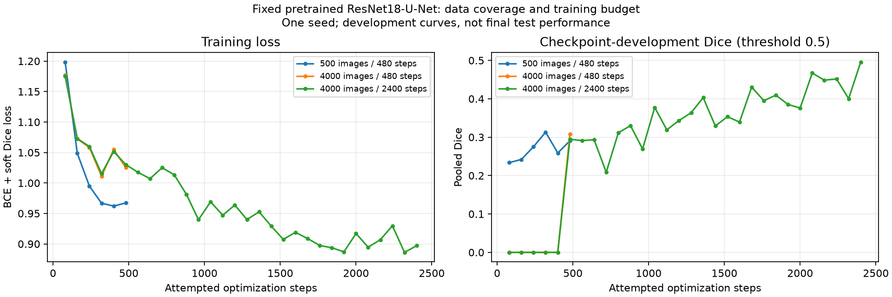

# 扩展训练覆盖与预算 / Expanded coverage and training budget

日期 / Date: 2026-11-23

## 设计 / Design

固定预训练 ResNet18-U-Net、BCE+soft Dice、AdamW lr=0.001、256×256 切块、4 正+4 负块采样、翻转增强和 AMP。依次比较：500 原图/480 步、4000 原图/480 步、相同4000 原图/2400 步。原80张检查点验证、200张正常校准和200张评估图身份及规则不变，测试集不参与。

Hold architecture, pretraining, loss, optimizer, tiles, sampling, augmentation and AMP fixed. Compare 500 images/480 steps, 4000 images/480 steps, and the same 4000 images/2400 steps. All development/calibration/evaluation identities and rules are unchanged; the test split remains unused.

4000 张仅来自 train，含2000正常、2000缺陷，保留上一版类别覆盖实验的全部500张。类别1/2/3/4分别出现于310/120/1471/241张图；多类别重复计数。共有9530个含缺陷块和38470个无缺陷块，按需读取。每类至少120张不等于每类像素或采样次数相同。

The 4000-image train-only pool has 2000 normal and 2000 defective images, includes all 500 coverage-baseline images, and contains class 1/2/3/4 in 310/120/1471/241 images (overlapping). It yields 9530 positive and 38470 negative tiles. Parent coverage does not imply equal pixel/update exposure.

## 结果 / Results

| 训练池 / Pool | 步数 / Steps | Image AUROC | TP/100 | FP/100 | Pooled Dice | Pooled IoU |
|---|---:|---:|---:|---:|---:|---:|
| 500 | 480 | 0.6121 | 10 | 3 | 0.3443 | 0.2079 |
| 4000 | 480 | 0.5150 | 0 | 0 | 0.3657 | 0.2238 |
| 4000 | 2400 | 0.7926 | 23 | 6 | 0.5218 | 0.3530 |

Dice/IoU 合并200张完整256×1600图的像素，包含正常误报像素。图像分数仍取最大预测概率；像素阈值在检查点开发集选取，图像阈值用正常校准分数q95，均不依据评估集调整。

Dice/IoU pool pixels across 200 full-resolution strips, including normal false positives. Image scores remain probability maxima. Pixel thresholds are selected on checkpoint development images; image thresholds use normal-calibration q95, not evaluation labels.

仅扩大池但维持短预算没有解决报警：0误报伴随0检出，不是成功。长预算在本轮改善分割和整图排序，但23%召回仍不足以部署。与原小U-Net的25/100检出、7/100误报相比，不能据此说所有报警指标都提升。

Data expansion alone with the short budget does not fix alarms: zero false positives with zero true positives is not success. Longer training improves segmentation and ranking in this run, but 23% recall is not deployable. It does not dominate the original small U-Net's 25/100 detections and 7/100 false alarms.

## 掩码与类别 / Masks and classes

2400步版本的正常像素误报从500图版本6.03%降至1.50%；但100张正常图仍有94张产生非空掩码（原版91张）。误报面积减少不等于正常图不再出现错误区域。

Normal-pixel FPR falls from 6.03% to 1.50%, but 94/100 normal images still have nonempty masks (previously 91/100). Smaller false regions do not mean false regions are absent.

类1/2/3/4的像素召回分别为23.75%/46.92%/53.51%/32.01%。第2类定位有改善，但6张含第2类的评估图仍无整图报警；第4类像素召回低于之前55.16%。各类样本少且多类图片重叠，不作显著性或普适结论。

Class-pixel recall is 23.75%/46.92%/53.51%/32.01% for classes 1/2/3/4. Class-2 localization improves, yet none of its six evaluation images alarms. Class-4 recall is below the earlier 55.16%. Small overlapping groups limit conclusions.

## 训练与复现限制 / Training and reproducibility limits

- 长版本30轮，每轮80次优化尝试；不等于30个完整epoch。本轮实际完成2400次，AMP跳过0次。最佳检查点在第30轮。曲线仍有波动，不能推断已经收敛。
  Thirty rounds of 80 attempts are not 30 full epochs. All 2400 steps completed, AMP skipped zero, best checkpoint round 30. Curves fluctuate; convergence is not established.
- 长版训练/校准/评估约220秒，峰值PyTorch分配显存约464 MiB；不含前置索引、不是稳定推理速度。每轮保存最佳训练权重和历史，最终推理权重独立保存。
  Long-run wall time is ~220 s and peak PyTorch allocation ~464 MiB, excluding indexing; this is not inference latency. Best weights/history are saved each round, final inference weights separately.
- 数据和验证清单、训练规则已核对。但虽然都设seed=42，两次4000图实验的最初480步曲线并不逐点一致（比较报告明确标记为false）。未强制GPU确定性，因此不能声称两次是完全相同轨迹的延长，也不能排除数值/随机差异对比较的影响。
  Data and rules match, but the first 480-step histories of the two expanded runs differ despite seed 42 (explicitly false in the comparison report). GPU determinism was not enforced; do not claim a bitwise-identical continuation or exclude stochastic/numerical effects.
- 仅一个种子，长版也有更多检查点选择机会，评估子集已反复查看；都是探索性开发结果。下一次严谨对照应固定确定性设置并做多种子复验，最终配置确定后再使用保留测试集。
  One seed, more checkpoint opportunities, and repeatedly inspected evaluation data limit inference. Next establish deterministic controls/multi-seed replication before final reserved-test evaluation.

## 学习曲线 / Learning curves



左图训练损失，右图检查点验证Dice（固定0.5阈值），不是最终测试指标。短实验与长实验前缀不完全一致，图中如实展示。

Left: training loss; right: checkpoint-development Dice at threshold 0.5, not test metrics. Nonidentical run prefixes are shown as recorded.

## 复现 / Reproduce

```powershell
python scripts/train_steel_unet.py --coverage-balanced --encoder pretrained-resnet18 --expanded
python scripts/train_steel_unet.py --coverage-balanced --encoder pretrained-resnet18 --expanded --rounds 30
python scripts/analyze_unet.py --coverage-balanced --encoder pretrained-resnet18 --expanded --rounds 30
python scripts/compare_training_scale.py
python -m pip install -r requirements-plots.txt
python scripts/plot_training_scale.py
```

单图推理 / Single-image inference:

```powershell
python scripts/train_steel_unet.py --coverage-balanced --encoder pretrained-resnet18 --expanded --rounds 30 --image data/severstal/034941f9d.jpg
```

32项测试通过，扩展选择包含原池、训练/验证身份隔离、同池复现均有检查；检查点重载、分组诊断的历史指标一致性与单图入口已运行。数据/权重/包含数据集图片的预览均保持本机，GitHub只提交代码、清单、指标和不含数据图片的学习曲线。

All 32 tests pass; selection preservation/isolation/determinism, checkpoint reload, metric consistency and single-image inference are checked. Data, weights and dataset-image previews remain local; code, identities, metrics and learning curves are versioned.
